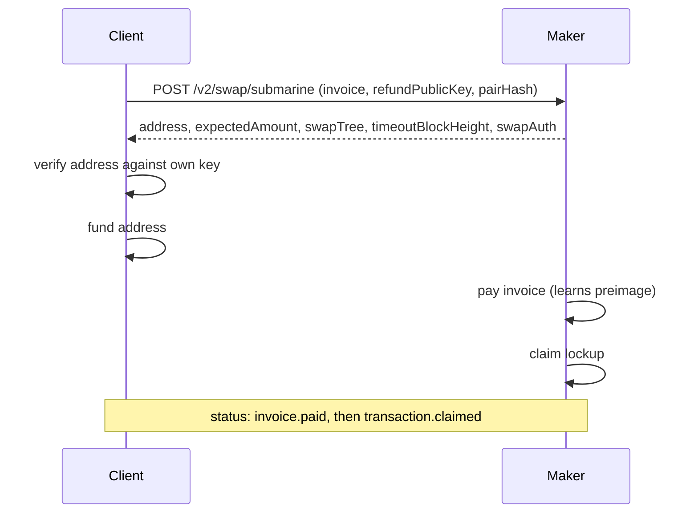
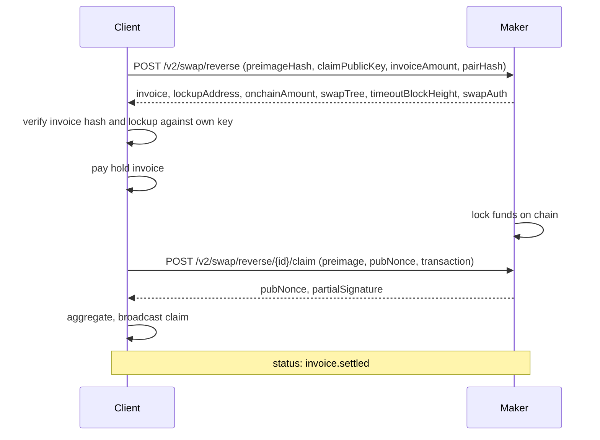

Submarine, reverse, and chain swaps follow the Boltz `/v2` protocol. Both legs of a swap are locked to the hash of one secret, the preimage: the Lightning payment as a hold invoice, and the on-chain funds in a Taproot output that can be claimed with the preimage or refunded after a timeout. Claiming reveals the preimage, which settles the other leg.

## Every swap

<Steps>
  <Step title="Pick a pair">
    `GET /v2/swap/{type}/pairs` returns `from → to → card`. Check the amount against the card's `limits` and keep its `hash`.
  </Step>
  <Step title="Create">
    `POST /v2/swap/{submarine,reverse,chain}` with your public key(s) and `pairHash`. Send your organization key or API key here if you have one. Store the full response, including `swapAuth`.
  </Step>
  <Step title="Verify before funding">
    Rebuild the swap tree from your own key, the maker's `refundPublicKey` or `claimPublicKey`, the preimage hash, and `timeoutBlockHeight`. Derive the Taproot address and compare it with the response. For reverse swaps, decode the invoice and check that its payment hash is your preimage hash. **Do not fund a swap that fails any check.**
  </Step>
  <Step title="Fund or pay">
    Fund the lockup with exactly the expected amount in one transaction, or pay the invoice.
  </Step>
  <Step title="Follow status">
    `GET /v2/swap/{id}`, or subscribe on `GET /v2/ws`.
  </Step>
  <Step title="Claim or refund">
    Claim cooperatively through the claim endpoint, or alone through the script path. Refund cooperatively before the timeout, or alone after it.
  </Step>
</Steps>

## Submarine: on-chain → Lightning



| Step | Call |
|---|---|
| Lockup seen by the maker | `GET /v2/swap/submarine/{id}/transaction` |
| Proof of payment | `GET /v2/swap/submarine/{id}/preimage` |
| Cooperative refund if it fails | `POST /v2/swap/submarine/{id}/refund` with `X-Swap-Auth` |

## Reverse: Lightning → on-chain



| Step | Call |
|---|---|
| Maker's lockup | `GET /v2/swap/reverse/{id}/transaction` |
| Cooperative claim | `POST /v2/swap/reverse/{id}/claim` |
| Abandon (release your payment) | `POST /v2/swap/reverse/{id}/refund` with `X-Swap-Auth` |

The claim must confirm before `timeoutBlockHeight`. If the maker does not cooperate, spend the claim leaf with the preimage and your signature.

## Chain: on-chain → on-chain

| Step | Call |
|---|---|
| Create | `POST /v2/swap/chain` with `preimageHash`, `claimPublicKey`, `refundPublicKey`, and one of `userLockAmount` / `serverLockAmount` |
| Verify | Both `lockupDetails` (where you lock) and `claimDetails` (where the maker locks) |
| Both lockups | `GET /v2/swap/chain/{id}/transactions` |
| Re-quote, if you locked a different amount | `GET /v2/swap/chain/{id}/quote`, then `POST` the same amount with `X-Swap-Auth` |
| Claim your payout | Spend `claimDetails` with the preimage |
| Co-sign the maker's claim of your lockup | `POST /v2/swap/chain/{id}/claim` |
| Cooperative refund | `POST /v2/swap/chain/{id}/refund` with `X-Swap-Auth` |

## Status values

| Status | Meaning |
|---|---|
| `swap.created` / `invoice.set` | Created |
| `transaction.mempool` / `transaction.confirmed` | A lockup was seen / confirmed |
| `transaction.server.mempool` / `transaction.server.confirmed` | The maker's lockup on the destination chain (chain swaps) |
| `invoice.pending` / `invoice.paid` | The maker is paying / paid the invoice (submarine) |
| `transaction.claim.pending` / `transaction.claimed` | Claim in progress / done |
| `invoice.settled` | The hold invoice settled (reverse success) |
| `invoice.failedToPay`, `transaction.lockupFailed` | Failed: refund the lockup |
| `swap.expired`, `invoice.expired`, `transaction.failed`, `transaction.refunded` | Expired or failed |

A status is the maker's report. Check lockups and the chain tip on your own chain backend before claiming or refunding.

## WebSocket

```json
→ { "op": "subscribe", "channel": "swap.update", "args": ["<swap id>"] }
← { "event": "update", "channel": "swap.update", "args": [{ "id": "<swap id>", "status": "transaction.confirmed" }] }
→ { "op": "ping" }
← { "event": "pong" }
```

## Atomic RGB swaps

Atomic swaps have no lockup and no refund: one transaction moves both legs. The client's rgb-lib wallet signs; the maker signs last and broadcasts.

| Step | Call |
|---|---|
| Pairs | `GET /v2/swap/atomic/pairs` |
| Quote and rgb-lib offer | `POST /v2/swap/atomic/quote`. Check the offer moves the quoted amounts and asset |
| Request → unsigned proposal | `POST /v2/swap/atomic/{id}/request`. Check none of your coins are listed as the maker's |
| Completion → broadcast | `POST /v2/swap/atomic/{id}/complete` |
| Status | `GET /v2/swap/atomic/{id}` |
