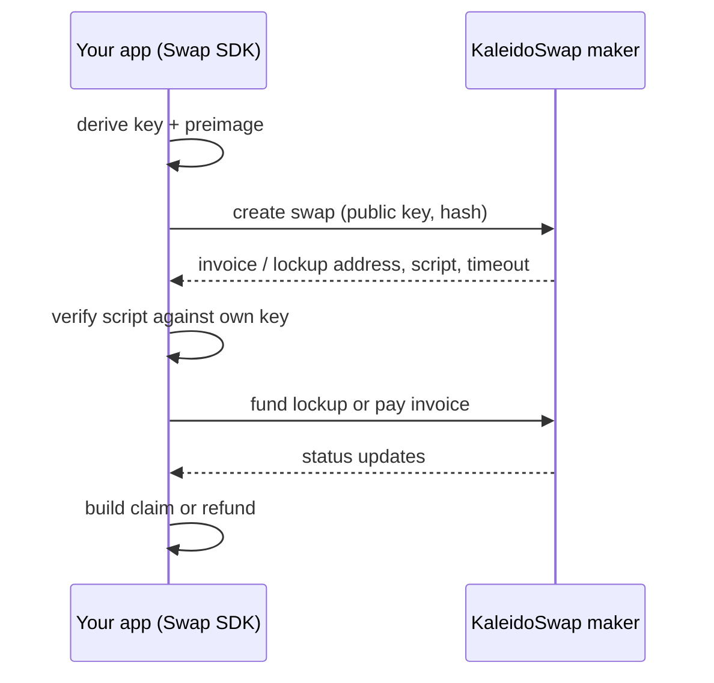

The Swap SDK lets a wallet or app swap between Bitcoin layers against the KaleidoSwap maker without handing custody to anyone. Your app keeps its keys. The SDK quotes a swap, checks every contract the maker proposes, and builds the claim or refund transaction on your side.

It is one Rust engine published for four runtimes:

| Runtime | Package |
|---|---|
| TypeScript (browser and Node) | `@kaleidorg/swap-sdk` on npm |
| Python | `kaleidorg_swap_sdk` on PyPI |
| React Native (iOS and Android) | `@kaleidorg/swap-sdk-react-native` on npm |
| Rust | `kaleidorg-swap-sdk`, installed from a git tag |

## What it does

- **Quotes and creates swaps** against the KaleidoSwap maker's `/v2` API: submarine (on-chain → Lightning), reverse (Lightning → on-chain), and chain (on-chain → on-chain) swaps.
- **Verifies before you fund.** Every create response is checked against your own keys: the swap script, the lockup address, the timeout, and the hash the Lightning invoice commits to. A response that does not match fails before any money moves.
- **Derives keys and preimages client-side** from your wallet mnemonic (BIP85). No key material leaves your app.
- **Builds claims and refunds.** Cooperative (MuSig2 key-spend, cheapest) when the maker co-signs, script-path when it does not, so a refund never depends on the maker.
- **Covers more than BTC.** L-BTC and L-USDT on Liquid, USDT on RGB (HTLC swaps and single-transaction atomic swaps), and bitcoin on Arkade through the Intents corridor.

## What it does not do

The SDK owns no wallet. Your app funds lockups, pays invoices, and stores swap records. The SDK tells you exactly what to fund and hands you signed transactions; it does not hold balances, run background timers, or broadcast on its own unless you ask it to.

## How a swap works

Every HTLC swap uses one secret (the preimage) and its hash. Both legs of the swap are locked to that hash: the Lightning payment on one side and an on-chain output on the other. Revealing the preimage to claim one leg is what lets the other side claim theirs, so either both legs settle or both can be refunded after a timeout.

[Swap types](/sdk/swap-types) explains which kind of swap fits which route, and [Swap lifecycle](/sdk/how-to-swap) follows one from creation to settlement.

## Networks

The SDK resolves the KaleidoSwap maker on **signet** (settling on Mutinynet) and on a local **regtest** harness. Mainnet is not served yet: asking for it returns an error instead of falling back to another provider. See [Networks](/sdk/networks).

<Note>
Looking for programmatic control of your own RGB Lightning Node (channels, RGB assets, payments, node-to-node swaps)? That is the [Node SDK](/cli/node-sdk/introduction), documented with the CLI.
</Note>

## Next steps

<CardGroup cols={2}>
  <Card title="Installation" icon="download" href="/sdk/installation">
    Install the package for your runtime.
  </Card>
  <Card title="Getting started" icon="rocket" href="/sdk/getting-started">
    List the maker's routes and make a first swap on signet.
  </Card>
  <Card title="Swap types" icon="shuffle" href="/sdk/swap-types">
    Submarine, reverse, chain, RGB, and Arkade.
  </Card>
  <Card title="Client reference" icon="book" href="/sdk/api-reference">
    Every client, method, and helper.
  </Card>
</CardGroup>
