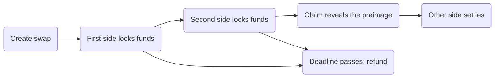

## One secret, two locks

Every swap except pay-through and atomic RGB swaps works the same way. One side generates a random secret, the **preimage**, and shares only its hash. Both legs of the swap are locked to that hash:

- the Lightning payment, as a **hold invoice** that settles only when someone reveals the preimage, and
- the on-chain funds, in a **lockup** output that can be spent in two ways: with the preimage (the claim), or by the original sender after a deadline (the refund).

Claiming the on-chain funds reveals the preimage on chain, and that is exactly what the other side needs to settle the Lightning payment. So either both legs settle, or neither does and the money goes back.

## Who does what on each route

| Route | Who pays first | Who claims on chain | If it fails |
|---|---|---|---|
| **On-chain → Lightning** (submarine) | You lock on chain | The maker, after paying your invoice | You refund your lockup after the deadline, or earlier if the maker co-signs |
| **Lightning → on-chain** (reverse) | You pay a hold invoice | You | Your Lightning payment is released back to you automatically |
| **Chain → chain** (chain) | You lock on the source chain | You, on the destination chain | You refund your lockup |
| **Atomic RGB** | Nobody: one transaction moves both sides | — | The transaction never confirms, and nothing moved |
| **Arkade ↔ Lightning** | Depends on direction | The receiving side, through the Arkade venue | Refund through the Arkade venue |
| **Pay-through** | The payer, with a hold invoice | — | The hold is released if the maker never pays out |

The technical names in parentheses (submarine, reverse, chain) come from the Boltz protocol the SDK speaks. The SDK methods use them: `createSubmarineSwap`, `createReverseSwap`, `createChainSwap`.

## Who holds the secret

- **On-chain → Lightning:** the person who issued the Lightning invoice holds the preimage. The maker learns it by paying the invoice, and only then can it claim your lockup.
- **Lightning → on-chain** and **chain → chain:** your app derives the preimage. You reveal it when you claim.

## Cheap path and safe path

A lockup can be claimed or refunded two ways:

- **Cooperatively.** You and the maker sign together (MuSig2). The transaction is smaller, looks like a normal payment, and a refund does not have to wait for the deadline.
- **Alone, through the script.** With the preimage for a claim, or after the deadline for a refund. This never depends on the maker.

The SDK tries the cooperative path first and falls back to the script path. See [Claims and refunds](/sdk/claims-and-refunds).

## The two exceptions

- **Atomic RGB swaps** move both sides in one Bitcoin transaction your RGB wallet co-signs. There is no lock, no deadline, and no refund. See [Swap BTC and USDT on RGB](/sdk/rgb-swaps#atomic-swaps-on-l1).
- **Pay-through** holds the payer's Lightning payment until the maker broadcasts the payout, but the payout itself is not locked: the maker controls it. See [Pay an address from Lightning](/sdk/pay-through).

Next: [Swap states](/sdk/how-to-swap) follows each route step by step, and [Trust model](/sdk/trust-model) covers what each step guarantees.
